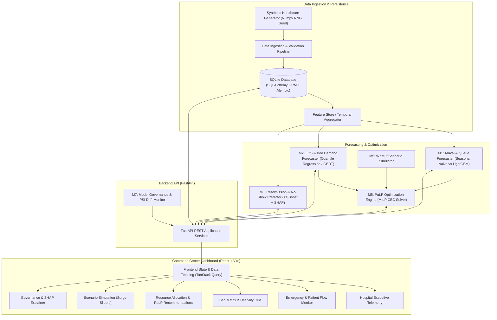
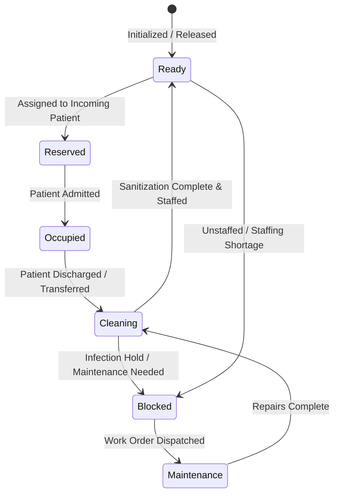

# System Architecture: Integrated Hospital Operations Intelligence Platform

**Document Version:** 1.0.0  
**Status:** Approved Phase 0 Baseline  
**Target Environment:** Local Reproducible Development (Python 3.11+, Node.js v20+, SQLite/PostgreSQL)  

---

## 1. High-Level Architecture Overview

The platform is designed as a **clean, modular monorepo** separating the presentation telemetry dashboard, API application layer, domain business rules, machine-learning inference engines, and mathematical optimization solvers.



---

## 2. Repository Structure (Modular Monorepo)

```text
hospital-operations-intelligence/
├── .agents/                                # Antigravity agent configuration and custom skills
│   └── skills/
│       └── hospital-ml-development/
├── backend/                                # Python FastAPI Backend
│   ├── app/
│   │   ├── api/                            # REST route controllers
│   │   │   ├── v1/
│   │   │   │   ├── endpoints/
│   │   │   │   │   ├── arrivals.py         # M1 arrival forecast endpoints
│   │   │   │   │   ├── beds.py             # M2 operational capacity & bed states
│   │   │   │   │   ├── inventory.py        # M3 pharmacy & equipment endpoints
│   │   │   │   │   ├── workforce.py        # M4 shift coverage endpoints
│   │   │   │   │   ├── optimization.py     # M5 PuLP solver endpoints
│   │   │   │   │   ├── simulation.py       # M5 what-if scenario endpoints
│   │   │   │   │   ├── continuity.py       # M6 readmission & SHAP endpoints
│   │   │   │   │   └── governance.py       # M7 drift & audit endpoints
│   │   │   ├── deps.py                     # Dependency injection (DB session, security)
│   │   ├── core/                           # Configuration, logging, security settings
│   │   ├── db/                             # SQLAlchemy models, sessions, base classes
│   │   ├── domain/                         # Business logic & operational rules
│   │   │   ├── bed_lifecycle.py            # Bed state machine validation
│   │   │   └── capacity_calculator.py      # Staffed vs physical bed calculations
│   │   ├── schemas/                        # Pydantic request/response schemas
│   │   └── services/                       # Orchestration services
│   ├── ml/                                 # Machine Learning Pipelines
│   │   ├── features/                       # Time-series feature engineering
│   │   ├── models/                         # Serialized model artifacts (.joblib / .json)
│   │   ├── baselines/                      # Seasonal Naive, Moving Average baselines
│   │   ├── training/                       # Offline training & rolling-origin CV scripts
│   │   ├── inference/                      # Real-time inference wrappers
│   │   └── explainability/                 # SHAP explainer pipelines
│   ├── optimization/                       # Mathematical Programming
│   │   ├── solvers/                        # PuLP MILP formulation & CBC solver
│   │   ├── constraints/                    # Hard & soft constraint definitions
│   │   └── scenarios/                      # What-if simulation parameters
│   └── tests/                              # Backend pytest suite
├── frontend/                               # React + TypeScript + Vite Dashboard
│   ├── src/
│   │   ├── assets/                         # Static assets and icons
│   │   ├── components/                     # Reusable UI components
│   │   │   ├── common/                     # Buttons, Badges, Modals, Cards
│   │   │   ├── telemetry/                  # Live stat dials, gauges, ticker alerts
│   │   │   ├── charts/                     # Forecast line charts, SHAP waterfalls
│   │   │   └── beds/                       # Interactive bed grid & status cards
│   │   ├── pages/                          # Primary view routes
│   │   │   ├── OverviewDashboard.tsx       # Executive command center
│   │   │   ├── EmergencyFlowPage.tsx       # ED arrivals, queue, waiting times
│   │   │   ├── BedManagementPage.tsx       # Bed state machine & capacity
│   │   │   ├── OptimizationPage.tsx        # PuLP allocation recommendations
│   │   │   ├── SimulationPage.tsx          # Interactive surge sliders
│   │   │   ├── GovernancePage.tsx          # Model drift & SHAP diagnostics
│   │   │   └── ContinuityPage.tsx          # Readmission risk inspection
│   │   ├── services/                       # Axios / Fetch API clients
│   │   ├── types/                          # TypeScript API interfaces
│   │   └── App.tsx                         # Layout & routing
│   ├── tailwind.config.js                  # Dark-mode command-center palette
│   └── package.json
├── data/                                   # Synthetic data generation & fixtures
│   ├── generator/                          # Python synthetic generator scripts
│   └── fixtures/                           # Seed datasets (.csv / .json / .sqlite)
├── docs/                                   # System architecture & documentation
└── tests/                                  # End-to-end integration test runners
```

---

## 3. Operational Bed Lifecycle State Machine

To prevent double-counting and avoid treating unstaffed or contaminated beds as operational capacity, bed transitions are strictly enforced via a state machine:



### Transition Integrity Rules
1. A bed in `Cleaning` or `Maintenance` **cannot** receive a new patient admission (`Occupied`).
2. An unoccupied, clean physical bed (`Ready`) is dynamically flagged as `UNSTAFFED` if the active nurse-to-patient ratio for that ward exceeds hospital safety thresholds.
3. Every state change generates an immutable `BedStatusEvent` record containing `bed_id`, `from_state`, `to_state`, `changed_at`, and `changed_by_user_id`.

---

## 4. PuLP Mathematical Optimization Architecture

The optimization engine resides in `backend/optimization/` and executes Mixed-Integer Linear Programming models solved via the COIN-OR Branch and Cut (CBC) solver:

### Mathematical Model Formulation (Centerpiece: Dynamic Bed & Acuity Allocation)
* **Decision Variables:**  
  $$x_{i, j, k} \in \{0, 1\}$$  
  Denotes binary assignment of patient $i$ to bed $j$ in ward $k$.
* **Objective Function:**  
  $$\min \sum_{i} \text{WaitTime}_i \cdot x_{i, j, k} + \sum_{i, k \neq \text{PreferredWard}_i} \text{PenaltyTransfer} \cdot x_{i, j, k} + \sum_{k} \text{OverCapacityPenalty}_k$$
* **Non-Negotiable Hard Constraints:**
  1. **Acuity & Specialty Compatibility:** Intensive care patients ($Acuity = 1$) can strictly only be allocated to ICU-certified beds ($Specialty_{j} = \text{ICU}$).
  2. **Infection / Isolation Rules:** Patients requiring negative-pressure isolation cannot be placed in general open-ward beds.
  3. **Capacity & State Limit:** A bed can hold at most one patient, and $x_{i, j, k} = 0$ if $\text{BedState}_j \neq \text{'Ready'}$.
  4. **Staff Ratio Constraint:** Total occupied beds in ward $k$ cannot exceed $\text{ActiveNurses}_k \times \text{MaxPatientsPerNurse}_k$.
* **Infeasibility Safeguard:** If hard constraints cannot be satisfied, the solver halts, returns `Status: Infeasible`, and generates a deterministic report specifying which constraint boundary was violated (e.g., *“ICU bed deficit: 4 patients cannot be safely placed”*), preventing any hallucinated allocations.

---

## 5. Security, Auditability, and Access Control

1. **Role-Based Access Control (RBAC):**
   * `Administrator`: Full system and user governance.
   * `OperationsManager`: Read/write access to bed assignments, optimization triggers, and what-if simulations.
   * `ClinicalReviewer`: Authorized access to readmission risk scores, triage queue views, and SHAP patient-level explanations.
   * `Viewer`: Read-only access to high-level aggregated operational telemetry.
2. **Audit Trail Logging:** All optimization runs, manual bed status overrides, and clinical risk reviews are recorded in an append-only `AuditEvent` database table.
3. **Data Protection:** No patient identifiers (PII) are stored. Patient records use synthetic surrogate hashes (`enc_7f9a2b`).
