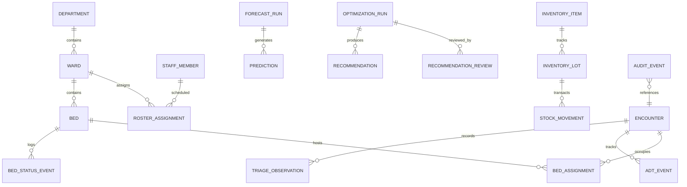

# Canonical Data Model: Integrated Hospital Operations Intelligence Platform

**Document Version:** 1.0.0  
**Status:** Approved Phase 0 Baseline  
**Database Engine:** SQLite (Local Dev) / PostgreSQL (Production Compatible)  
**ORM:** SQLAlchemy 2.0+ with Pydantic v2 validation  

---

## 1. Entity-Relationship Diagram (ERD)

---

## 2. Core Operational Entities & Schema Specifications

### 2.1 Hospital & Capacity Management

#### Table: `departments`
Stores hospital divisions (Emergency, Inpatient, Surgical, ICU, Outpatient).
* `id`: VARCHAR(36) [PK]
* `code`: VARCHAR(20) [UNIQUE, NOT NULL] (e.g., `ED`, `ICU`, `GEN_MED`, `SURG`)
* `name`: VARCHAR(100) [NOT NULL]
* `created_at`: TIMESTAMP [NOT NULL, DEFAULT UTC_NOW]

#### Table: `wards`
Physical patient care units within a department.
* `id`: VARCHAR(36) [PK]
* `department_id`: VARCHAR(36) [FK -> departments.id, NOT NULL]
* `code`: VARCHAR(20) [NOT NULL] (e.g., `ICU_NORTH`, `WARD_4B`)
* `specialty`: VARCHAR(50) [NOT NULL] (`General`, `Cardiac`, `Pediatric`, `Isolation`)
* `total_physical_beds`: INTEGER [NOT NULL, CHECK > 0]
* `target_nurse_to_patient_ratio`: FLOAT [NOT NULL, DEFAULT 0.25] (1 nurse per 4 patients)

#### Table: `beds`
Physical beds within a ward, tracking current operational state.
* `id`: VARCHAR(36) [PK]
* `ward_id`: VARCHAR(36) [FK -> wards.id, NOT NULL]
* `bed_number`: VARCHAR(20) [NOT NULL] (e.g., `B-101`)
* `current_state`: VARCHAR(20) [NOT NULL, DEFAULT 'Ready']  
  *Allowed States:* `'Ready'`, `'Reserved'`, `'Occupied'`, `'Cleaning'`, `'Maintenance'`, `'Blocked'`
* `is_isolation_capable`: BOOLEAN [NOT NULL, DEFAULT FALSE]
* `is_telemetry_capable`: BOOLEAN [NOT NULL, DEFAULT FALSE]
* `last_state_change`: TIMESTAMP [NOT NULL, DEFAULT UTC_NOW]

#### Table: `bed_status_events`
Immutable historical log of all bed lifecycle transitions.
* `id`: VARCHAR(36) [PK]
* `bed_id`: VARCHAR(36) [FK -> beds.id, NOT NULL]
* `from_state`: VARCHAR(20) [NOT NULL]
* `to_state`: VARCHAR(20) [NOT NULL]
* `reason`: VARCHAR(255) [NULLABLE] (e.g., `Discharge Sanitization`, `HVAC Repair`)
* `recorded_at`: TIMESTAMP [NOT NULL, DEFAULT UTC_NOW]
* `recorded_by`: VARCHAR(50) [NOT NULL]

---

### 2.2 Patient Encounters & Flow Tracking

#### Table: `encounters`
Pseudonymized patient visits (No direct identifiers/PII).
* `id`: VARCHAR(36) [PK]
* `patient_anon_id`: VARCHAR(64) [NOT NULL, INDEX] (HMAC-SHA256 hashed pseudonym)
* `encounter_type`: VARCHAR(20) [NOT NULL] (`Emergency`, `Inpatient`, `Elective`)
* `arrival_time`: TIMESTAMP [NOT NULL, INDEX]
* `admitted_time`: TIMESTAMP [NULLABLE]
* `discharge_time`: TIMESTAMP [NULLABLE]
* `disposition`: VARCHAR(50) [NULLABLE] (`Home`, `Transferred`, `Deceased`, `AMA`)
* `primary_diagnosis_category`: VARCHAR(100) [NULLABLE]
* `actual_los_hours`: FLOAT [NULLABLE] (Computed upon discharge)

#### Table: `triage_observations`
Emergency department triage condition upon arrival.
* `id`: VARCHAR(36) [PK]
* `encounter_id`: VARCHAR(36) [FK -> encounters.id, NOT NULL, UNIQUE]
* `esi_score`: INTEGER [NOT NULL, CHECK 1-5] (Emergency Severity Index: 1=Immediate Resuscitation, 5=Non-urgent)
* `chief_complaint`: VARCHAR(100) [NOT NULL]
* `triage_timestamp`: TIMESTAMP [NOT NULL]
* `requires_isolation`: BOOLEAN [NOT NULL, DEFAULT FALSE]

#### Table: `adt_events`
Admission, Discharge, and Transfer tracking across hospital wards.
* `id`: VARCHAR(36) [PK]
* `encounter_id`: VARCHAR(36) [FK -> encounters.id, NOT NULL]
* `event_type`: VARCHAR(20) [NOT NULL] (`ADMISSION`, `TRANSFER`, `DISCHARGE`)
* `from_ward_id`: VARCHAR(36) [FK -> wards.id, NULLABLE]
* `to_ward_id`: VARCHAR(36) [FK -> wards.id, NULLABLE]
* `event_timestamp`: TIMESTAMP [NOT NULL, INDEX]

---

### 2.3 Workforce & Shift Scheduling

#### Table: `staff_members`
Clinical staff registry.
* `id`: VARCHAR(36) [PK]
* `employee_code`: VARCHAR(20) [UNIQUE, NOT NULL]
* `role`: VARCHAR(30) [NOT NULL] (`Physician`, `Staff_Nurse`, `Charge_Nurse`, `Technician`)
* `specialty_qualification`: VARCHAR(50) [NOT NULL] (`Emergency`, `ICU`, `Medical_Surgical`)
* `is_active`: BOOLEAN [NOT NULL, DEFAULT TRUE]

#### Table: `roster_assignments`
Shift schedules and actual attendance tracking.
* `id`: VARCHAR(36) [PK]
* `staff_id`: VARCHAR(36) [FK -> staff_members.id, NOT NULL]
* `ward_id`: VARCHAR(36) [FK -> wards.id, NOT NULL]
* `shift_date`: DATE [NOT NULL, INDEX]
* `shift_type`: VARCHAR(20) [NOT NULL] (`Morning`, `Evening`, `Night`)
* `start_time`: TIMESTAMP [NOT NULL]
* `end_time`: TIMESTAMP [NOT NULL]
* `status`: VARCHAR(20) [NOT NULL, DEFAULT 'Scheduled'] (`Scheduled`, `Present`, `Absent`, `OnCall`)

---

### 2.4 Pharmacy & Inventory (FEFO Support)

#### Table: `inventory_items`
Catalog of essential medicines, blood units, and medical consumables.
* `id`: VARCHAR(36) [PK]
* `sku_code`: VARCHAR(30) [UNIQUE, NOT NULL]
* `generic_name`: VARCHAR(100) [NOT NULL]
* `category`: VARCHAR(50) [NOT NULL] (`Antibiotic`, `Analgesic`, `Oxygen_Cylinder`, `Blood_PRBC`)
* `unit_of_measure`: VARCHAR(20) [NOT NULL] (`Vial`, `Tablet`, `Liter`, `Unit`)
* `reorder_threshold`: INTEGER [NOT NULL]
* `standard_lead_time_days`: INTEGER [NOT NULL, DEFAULT 2]

#### Table: `inventory_lots`
Batch and expiry tracking enabling First Expiry, First Out (FEFO) dispensing.
* `id`: VARCHAR(36) [PK]
* `item_id`: VARCHAR(36) [FK -> inventory_items.id, NOT NULL]
* `lot_number`: VARCHAR(50) [NOT NULL]
* `quantity_on_hand`: INTEGER [NOT NULL, CHECK >= 0]
* `expiry_date`: DATE [NOT NULL, INDEX]
* `received_date`: DATE [NOT NULL]

---

### 2.5 Machine Learning & Optimization Runs

#### Table: `forecast_runs`
Audit record of every executed forecasting job.
* `id`: VARCHAR(36) [PK]
* `model_name`: VARCHAR(50) [NOT NULL] (e.g., `LightGBM_ED_Arrivals_v1`)
* `horizon_hours`: INTEGER [NOT NULL] (24, 48, or 72)
* `granularity`: VARCHAR(20) [NOT NULL, DEFAULT 'Hourly']
* `run_timestamp`: TIMESTAMP [NOT NULL, DEFAULT UTC_NOW]
* `metrics_snapshot_json`: TEXT [NULLABLE] (Stores validation MAE, WAPE, RMSE)

#### Table: `predictions`
Individual forecasted values with uncertainty intervals.
* `id`: VARCHAR(36) [PK]
* `forecast_run_id`: VARCHAR(36) [FK -> forecast_runs.id, NOT NULL]
* `target_entity_type`: VARCHAR(30) [NOT NULL] (`Department_Arrivals`, `Ward_Bed_Occupancy`, `Patient_LOS`)
* `target_entity_id`: VARCHAR(36) [NOT NULL]
* `forecast_timestamp`: TIMESTAMP [NOT NULL, INDEX]
* `predicted_value`: FLOAT [NOT NULL]
* `lower_bound_80`: FLOAT [NULLABLE]
* `upper_bound_80`: FLOAT [NULLABLE]

#### Table: `optimization_runs`
Snapshots of PuLP Mixed-Integer Linear Programming executions.
* `id`: VARCHAR(36) [PK]
* `solver_status`: VARCHAR(30) [NOT NULL] (`Optimal`, `Infeasible`, `Unbounded`, `Feasible`)
* `objective_value`: FLOAT [NULLABLE]
* `hard_constraint_violations`: INTEGER [NOT NULL, DEFAULT 0]
* `input_snapshot_json`: TEXT [NOT NULL]
* `executed_at`: TIMESTAMP [NOT NULL, DEFAULT UTC_NOW]
* `execution_duration_ms`: INTEGER [NOT NULL]

#### Table: `recommendations`
Specific operational allocations generated by the optimizer.
* `id`: VARCHAR(36) [PK]
* `optimization_run_id`: VARCHAR(36) [FK -> optimization_runs.id, NOT NULL]
* `recommendation_type`: VARCHAR(50) [NOT NULL] (`Bed_Allocation`, `Nurse_Reassignment`, `Stock_Transfer`)
* `target_entity_id`: VARCHAR(36) [NOT NULL]
* `recommended_action`: TEXT [NOT NULL]
* `status`: VARCHAR(20) [NOT NULL, DEFAULT 'Proposed'] (`Proposed`, `Approved`, `Rejected`, `Overridden`)
* `reviewed_by`: VARCHAR(50) [NULLABLE]
* `reviewed_at`: TIMESTAMP [NULLABLE]
* `clinical_review_note`: TEXT [NULLABLE]

---

## 3. Data Integrity & Temporal Consistency Rules

1. **Temporal Sequence Validation:**  
   $T_{\text{arrival}} \le T_{\text{triage}} \le T_{\text{admission}} < T_{\text{discharge}}$. Records violating this temporal order are quarantined to the `data_quality_issues` table.
2. **Bed State Mutual Exclusivity:**  
   A bed cannot occupy two states simultaneously. Any transition without an explicit prior state matching the database state will be rejected with an `OptimisticConcurrencyError`.
3. **Audit Trail Completeness:**  
   Every recommendation approved or rejected by a human user must include a valid `reviewed_by` username and non-empty `clinical_review_note` if overridden.
