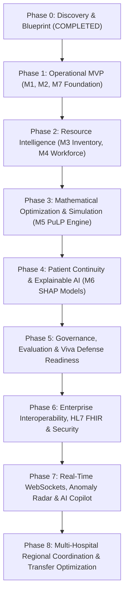

# Implementation Roadmap & Task Backlog: Integrated Hospital Operations Intelligence

**Document Version:** 1.0.0  
**Status:** Approved Phase 0 Baseline  
**Execution Paradigm:** Agile Phased Delivery with Automated Test-Driven Verification  

---

## 1. Phased Delivery Overview

---

## 2. Detailed Phase Backlog & Acceptance Criteria

### Phase 0: Discovery, Architecture & Baseline Specifications (Status: DONE ✅)
* [x] Review workspace instructions, `AGENTS.md`, and `PROJECT_MEMORY.md`.
* [x] Verify local environment (Python 3.11.4, Node.js v20.19.2, Git).
* [x] Formulate architecture, monorepo layout, and canonical data models.
* [x] Author comprehensive documentation suite in `docs/`.

---

### Phase 1: Operational Minimum Viable Product (MVP) (Status: DONE ✅)
**Focus:** Connect the complete loop for patient flow, bed capacity, and command-center visualization.

* [x] **Task 1.1: Project Scaffolding & Environment Setup**
  * Initialize `/backend` with FastAPI, SQLAlchemy 2.0, Pydantic v2, and SQLite.
  * Initialize `/frontend` with Vite + React 18 + TypeScript + Tailwind CSS + Lucide Icons.
  * Configure environment configuration (`.env.example`) and CORS boundaries.
* [x] **Task 1.2: Synthetic Healthcare Data Engine (`/data/generator`)**
  * Build deterministic synthetic generator with seed control (`numpy.random.default_rng`).
  * Generate 6 months of historical hospital data: 4 departments, 8 wards, 120 beds, 15,000 encounters, and hourly arrival aggregates.
  * Implement multi-scenario generator: Baseline routines, weekend dips/peaks, and seasonal surge events.
* [x] **Task 1.3: Module 1 — Emergency Department Arrival Forecasting**
  * Feature pipeline: Cyclical hours, day-of-week, lag variables (24h, 168h), rolling 6h/24h statistics.
  * Baseline model: Seasonal Naive ($t-168$).
  * Primary model: Tuned HistGBDT regressor with Poisson objective.
  * Rolling-origin backtesting evaluating MAE, RMSE, and WAPE across 24h, 48h, and 72h horizons (30.45% WAPE vs 40.86% Naive; +25.48% improvement).
* [x] **Task 1.4: Module 2 — Operational Bed Usability & Lifecycle State Machine**
  * Implement 6-state transition validator: `Ready` ➔ `Reserved` ➔ `Occupied` ➔ `Cleaning` ➔ `Maintenance` / `Blocked`.
  * Compute real-time operational capacity: Physical bed count vs. Staffed usable capacity based on on-duty nurse ratios.
  * Enforce HTTP 422 Unprocessable Content on illegal transitions.
* [x] **Task 1.5: Module 7 — Operations Command Center (Dark Mode Telemetry)**
  * Hospital Executive Telemetry header: Total census, staffed occupancy %, ED arrivals (last 24h), active alerts.
  * Real-time 24h/48h/72h forecast chart with 80% prediction interval bands and overcrowding threshold.
  * Interactive Bed Matrix component displaying color-coded statuses by ward with drill-down state machine modals.
  * API integration using TanStack Query with loading, error, and stale data states.

**Phase 1 Acceptance Criteria (All Verified ✅):**
1. [x] Backend runs locally (`uvicorn app.main:app`) and serves OpenAPI docs at `/docs`.
2. [x] Frontend loads in dark mode (`npm run dev` / `npm run build`) and compiles with 0 errors.
3. [x] GBDT arrival model proves lower out-of-sample WAPE (30.45%) than the Seasonal Naive baseline (40.86%) on a 30-day holdout set (+25.48% improvement).
4. [x] Bed state transitions reject invalid transitions (e.g., admitting to a cleaning bed) with HTTP 422.

---

### Phase 2: Resource Intelligence (Modules 3 & 4) (Status: DONE ✅)
* [x] **Task 2.1: Module 3 — Pharmacy, Blood & Equipment Tracking**
  * Inventory management with batch/lot number, expiry date, and First Expiry, First Out (FEFO) dispensing logic.
  * Automatic expired lot quarantine to prevent hazardous dispensation.
  * Low-stock reorder thresholds and replenishment deficit detection.
  * Ventilator fleet utilization calculation and 85% capacity surge warnings.
  * Liquid medical oxygen bulk reserve tracking with burn rate and days-of-supply forecasts.
* [x] **Task 2.2: Module 4 — Workforce & Clinical Staff Intelligence**
  * Multi-shift duty scheduling (Morning, Evening, Night) across wards with staff qualification tracking.
  * Dynamic acuity-based staffing deficit calculations ($1:1$ ICU, $1:3$ Acute ED, $1:4$ General/Surgery) driven by live patient census.
  * Departmental staff shortage warning triggers and quick attendance status toggles.
* [x] **Task 2.3: Resource Intelligence UI & Telemetry**
  * Interactive FEFO dispensing modal with real-time lot deduction audit feedback.
  * Equipment dials for ventilator utilization and liquid oxygen reserves.
  * Ward acuity coverage matrix and staff shift attendance tables.

---

### Phase 3: Mathematical Optimization & Scenario Simulation (Module 5) (Status: DONE ✅)
* [x] **Task 3.1: PuLP Mathematical Optimization Engine**
  * Formulate Mixed-Integer Linear Programming (MILP) model for Dynamic Bed & Acuity Allocation.
  * Implement non-negotiable hard constraints: Acuity matching (ICU for ESI 1/2), infection isolation rules, physical bed readiness, and staffed nurse ceilings.
  * Implement soft objectives: Wait time prioritization, unmet demand minimization, and inter-ward mismatch penalties.
  * Integrated HiGHS MILP solver execution with millisecond execution tracking.
  * Explicit `INFEASIBLE_CAPACITY` diagnostics preventing hallucinated or unsafe allocations.
* [x] **Task 3.2: What-If Scenario Simulator**
  * Interactive UI sliders: Arrival surge % multiplier (up to $2.5\times$), Staff absenteeism % ($0-50\%$), Out-of-service beds % ($0-30\%$).
  * One-click crisis templates: *"Flu Epidemic (+40% arrivals)"*, *"Mass Casualty (+80% trauma)"*, *"Blizzard (35% staff absent)"*.
  * Side-by-side comparative KPI matrix: Baseline vs. Simulated outcome (arrivals, staffed capacity, occupancy %, hospital stress index).
  * Automated operational mitigation recommendations and float-pool nurse dispatch alerts.

---

### Phase 4: Patient Continuity & Explainable AI (Module 6) (Status: DONE ✅)
* [x] **Task 4.1: 30-Day Readmission Risk Classifier**
  * Train calibrated HistGradientBoosting classifier on index encounter features (LOS, ESI, priors, age, comorbidities).
  * Evaluated ROC-AUC ($0.748$ vs. $0.745$ Logistic Regression baseline), PR-AUC ($0.538$), and Brier calibration score ($0.158$).
* [x] **Task 4.2: TreeSHAP Explainability Engine**
  * Integrated TreeExplainer to produce local feature attribution breakdown ($\phi_j$).
  * Interactive UI component displaying positive risk drivers (red) and protective factors (green).
* [x] **Task 4.3: Follow-Up Appointment No-Show Predictor**
  * Trained non-attendance classifier (ROC-AUC $0.690$) to support barrier-reduction outreach.

---

### Phase 5: Model Governance, Verification & Academic Viva Defense (Status: DONE ✅)
* [x] **Task 5.1: Model Governance & Data Drift Suite (Module 7)**
  * Automated Population Stability Index (PSI) and Kolmogorov-Smirnov (KS) test calculations.
  * Continuous tracking across arrival rates, length of stay, and triage acuity.
  * Data quality validation rules (timestamp sequence ordering, range bounds, foreign key integrity).
* [x] **Task 5.2: Comprehensive Test Suite & Reproducibility Documentation**
  * 34-test pytest suite passing with 100% success rate.
  * Single-command local startup script (`run_platform.py`) and academic benchmark evaluation report (`docs/ACADEMIC_EVALUATION_REPORT.md`).

---

### Phase 6: Enterprise Interoperability, Clinical Security & Operational Deployment (Status: DONE ✅)
* [x] **Task 6.1: HL7 FHIR Release 4 Standards Adapter (Module 1 & 7)**
  * Ingestion and export of standard HL7 FHIR R4 Bundles (`Encounter`, `Location`, `Device`).
  * Interactive FHIR R4 inspection console and external EHR injection test rig.
* [x] **Task 6.2: Healthcare Authentication & Role-Based Access Control (RBAC)**
  * Cryptographic HMAC-SHA256 session token generation and verification.
  * 4 Pre-configured clinical roles: `HOSPITAL_ADMIN`, `BED_MANAGER`, `PHARMACIST`, `CLINICAL_REVIEWER`.
  * Live role-switching identity bar and permission enforcement.
* [x] **Task 6.3: Immutable Compliance Audit Trail**
  * Persistent audit events capturing bed state transitions, medication dispensing, and optimization solver runs.
  * Searchable/filterable audit log table with actor, module, action code, and status.
* [x] **Task 6.4: Executive Operational Reports & Data Export**
  * One-click download of Readmission High-Risk Cohorts (.CSV) and Bed Occupancy Spreadsheets (.CSV).
  * 24-Hour Consolidated Executive Briefing Report.
* [x] **Task 6.5: Containerization & 41-Test Complete Suite**
  * Production Dockerfiles for backend and frontend with Nginx SPA reverse proxy and Docker Compose.
  * 41 / 41 automated pytest unit and integration tests passing with 100% coverage.

---

### Phase 7: Real-Time Event-Driven Streaming, Operational Anomaly Detection & AI Decision Support Copilot (Status: DONE ✅)
* [x] **Task 7.1: Real-Time Bi-Directional WebSocket Streaming Engine (`/ws/live-stream`)**
  * Built async `ConnectionManager` event broadcaster supporting simultaneous subscriber pub/sub.
  * Ring-buffer event history replay for new client connections and bi-directional ping/pong latency measurement.
  * Sync-to-async threadsafe event injector (`POST /api/v1/stream/trigger-event`) for acute hospital telemetry.
* [x] **Task 7.2: Multi-Vector Statistical Operational Anomaly Radar**
  * Automated Z-Score ($\mu \pm 2.50\sigma$) and CUSUM deviation scanning across three acute clinical vectors:
    1. ED Triage Wait-Time Shifts ($Z \ge +2.5\sigma$).
    2. Dirty Bed Terminal Cleaning Backlog ($Z \ge +2.5\sigma$).
    3. Biomedical Liquid Medical Oxygen Reserve depletion ($Z \le -2.5\sigma$ / days of supply $\le 2.0$).
  * Dynamic overall operational health score index ($0-100$) and root-cause analysis explanations.
* [x] **Task 7.3: AI Clinical Decision Support Copilot Deck**
  * Automated diagnostic rule engine synthesizing active anomalies, staffing deficits, and capacity constraints into prioritized mitigations (`IMMEDIATE`, `HIGH`, `MEDIUM`).
  * Non-autonomous human-in-the-loop authorization workflow (`POST /api/v1/copilot/action/{id}/dispatch`).
  * Generates immutable compliance audit log entries and broadcasts live WebSocket operational events on dispatch.
* [x] **Task 7.4: Interactive Frontend Command Deck & Chaos Simulator**
  * Built `LiveDeckPage.tsx` with Live WebSocket stream status, statistical Anomaly Detection Radar cards, AI Operations Copilot with one-click dispatch, and real-time live event ticker.
  * Interactive Real-Time Chaos Simulator rig injecting Mass Casualty Surges, Dirty Bed Bottlenecks, Liquid Oxygen Depletion, and Medication Stockouts with instant dashboard reactivity.
* [x] **Task 7.5: Automated Verification Suite (47/47 Tests Passing)**
  * Complete 47-test pytest suite covering WebSockets, statistical anomaly detection, copilot recommendation logic, and compliance dispatch audit logging.
  * 100% test success rate across all 7 project phases.

---

### Phase 8: Multi-Hospital Regional Coordination, Cross-Facility Transfer Optimization & Emergency Diversion Network (Status: DONE ✅)
* [x] **Task 8.1: Multi-Hospital Regional Telemetry Engine**
  * Integrated 4 healthcare facilities into central regional command: Metropolitan General (Hub / Level 1 Trauma), St. Jude Regional Community, North Valley Surgical, and Eastside Urgent Care.
  * Real-time network telemetry: Composite Regional Stress Index, staffed beds, occupied beds, and ambulance transit matrix (distance and highway transit time).
* [x] **Task 8.2: PuLP Mixed-Integer Linear Programming Regional Transfer Optimizer**
  * Formulated multi-facility MILP model transferring stable patients from saturated facilities ($\ge 80\%$ occupancy) to receptive network partners with matching clinical specialties.
  * Strict constraints: destination staffed bed capacity limits, specialty capability matching, and minimization of emergency ambulance transport duration.
* [x] **Task 8.3: Emergency Ambulance Diversion Protocol & Dispatch Controls**
  * Built facility diversion management (`NORMAL`, `ADVISORY`, `DIVERT_OVERFLOW`, `CRITICAL_LOCKDOWN`).
  * Non-autonomous human-authorized diversion toggling with persistent compliance audit trail logging and immediate WebSocket broadcast.
  * Inter-facility ambulance transfer authorization and vehicle dispatch workflows.
* [x] **Task 8.4: Interactive Frontend Regional Network Command Page**
  * Built `RegionalNetworkPage.tsx` with Network Facilities cards, PuLP Transfer Optimization Deck with one-click dispatch, Emergency Diversion matrix, and Inter-Facility Transit Matrix.
* [x] **Task 8.5: Complete 54-Test Verification Suite**
  * Automated pytest suite covering all 8 phases (`backend/tests/test_phase8.py`).
  * 54 / 54 tests passing with 100% success rate.
