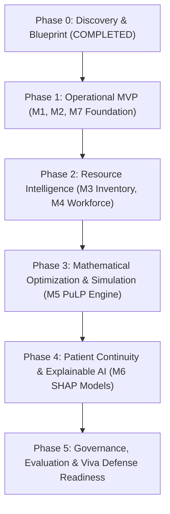

# Implementation Roadmap & Task Backlog: Integrated Hospital Operations Intelligence

**Document Version:** 1.0.0  
**Status:** Approved Phase 0 Baseline  
**Execution Paradigm:** Agile Phased Delivery with Automated Test-Driven Verification  

---

## 1. Phased Delivery Overview

---

## 2. Detailed Phase Backlog & Acceptance Criteria

### Phase 0: Discovery, Architecture & Baseline Specifications (Status: DONE ✅)
* [x] Review workspace instructions, `AGENTS.md`, and `PROJECT_MEMORY.md`.
* [x] Verify local environment (Python 3.11.4, Node.js v20.19.2, Git).
* [x] Formulate architecture, monorepo layout, and canonical data models.
* [x] Author comprehensive documentation suite in `docs/`.

---

### Phase 1: Operational Minimum Viable Product (MVP) (Status: DONE ✅)
**Focus:** Connect the complete loop for patient flow, bed capacity, and command-center visualization.

* [x] **Task 1.1: Project Scaffolding & Environment Setup**
  * Initialize `/backend` with FastAPI, SQLAlchemy 2.0, Pydantic v2, and SQLite.
  * Initialize `/frontend` with Vite + React 18 + TypeScript + Tailwind CSS + Lucide Icons.
  * Configure environment configuration (`.env.example`) and CORS boundaries.
* [x] **Task 1.2: Synthetic Healthcare Data Engine (`/data/generator`)**
  * Build deterministic synthetic generator with seed control (`numpy.random.default_rng`).
  * Generate 6 months of historical hospital data: 4 departments, 8 wards, 120 beds, 15,000 encounters, and hourly arrival aggregates.
  * Implement multi-scenario generator: Baseline routines, weekend dips/peaks, and seasonal surge events.
* [x] **Task 1.3: Module 1 — Emergency Department Arrival Forecasting**
  * Feature pipeline: Cyclical hours, day-of-week, lag variables (24h, 168h), rolling 6h/24h statistics.
  * Baseline model: Seasonal Naive ($t-168$).
  * Primary model: Tuned HistGBDT regressor with Poisson objective.
  * Rolling-origin backtesting evaluating MAE, RMSE, and WAPE across 24h, 48h, and 72h horizons (30.45% WAPE vs 40.86% Naive; +25.48% improvement).
* [x] **Task 1.4: Module 2 — Operational Bed Usability & Lifecycle State Machine**
  * Implement 6-state transition validator: `Ready` ➔ `Reserved` ➔ `Occupied` ➔ `Cleaning` ➔ `Maintenance` / `Blocked`.
  * Compute real-time operational capacity: Physical bed count vs. Staffed usable capacity based on on-duty nurse ratios.
  * Enforce HTTP 422 Unprocessable Content on illegal transitions.
* [x] **Task 1.5: Module 7 — Operations Command Center (Dark Mode Telemetry)**
  * Hospital Executive Telemetry header: Total census, staffed occupancy %, ED arrivals (last 24h), active alerts.
  * Real-time 24h/48h/72h forecast chart with 80% prediction interval bands and overcrowding threshold.
  * Interactive Bed Matrix component displaying color-coded statuses by ward with drill-down state machine modals.
  * API integration using TanStack Query with loading, error, and stale data states.

**Phase 1 Acceptance Criteria (All Verified ✅):**
1. [x] Backend runs locally (`uvicorn app.main:app`) and serves OpenAPI docs at `/docs`.
2. [x] Frontend loads in dark mode (`npm run dev` / `npm run build`) and compiles with 0 errors.
3. [x] GBDT arrival model proves lower out-of-sample WAPE (30.45%) than the Seasonal Naive baseline (40.86%) on a 30-day holdout set (+25.48% improvement).
4. [x] Bed state transitions reject invalid transitions (e.g., admitting to a cleaning bed) with HTTP 422.

---

### Phase 2: Resource Intelligence (Modules 3 & 4) (Status: DONE ✅)
* [x] **Task 2.1: Module 3 — Pharmacy, Blood & Equipment Tracking**
  * Inventory management with batch/lot number, expiry date, and First Expiry, First Out (FEFO) dispensing logic.
  * Automatic expired lot quarantine to prevent hazardous dispensation.
  * Low-stock reorder thresholds and replenishment deficit detection.
  * Ventilator fleet utilization calculation and 85% capacity surge warnings.
  * Liquid medical oxygen bulk reserve tracking with burn rate and days-of-supply forecasts.
* [x] **Task 2.2: Module 4 — Workforce & Clinical Staff Intelligence**
  * Multi-shift duty scheduling (Morning, Evening, Night) across wards with staff qualification tracking.
  * Dynamic acuity-based staffing deficit calculations ($1:1$ ICU, $1:3$ Acute ED, $1:4$ General/Surgery) driven by live patient census.
  * Departmental staff shortage warning triggers and quick attendance status toggles.
* [x] **Task 2.3: Resource Intelligence UI & Telemetry**
  * Interactive FEFO dispensing modal with real-time lot deduction audit feedback.
  * Equipment dials for ventilator utilization and liquid oxygen reserves.
  * Ward acuity coverage matrix and staff shift attendance tables.

---

### Phase 3: Mathematical Optimization & Scenario Simulation (Module 5) (Status: DONE ✅)
* [x] **Task 3.1: PuLP Mathematical Optimization Engine**
  * Formulate Mixed-Integer Linear Programming (MILP) model for Dynamic Bed & Acuity Allocation.
  * Implement non-negotiable hard constraints: Acuity matching (ICU for ESI 1/2), infection isolation rules, physical bed readiness, and staffed nurse ceilings.
  * Implement soft objectives: Wait time prioritization, unmet demand minimization, and inter-ward mismatch penalties.
  * Integrated HiGHS MILP solver execution with millisecond execution tracking.
  * Explicit `INFEASIBLE_CAPACITY` diagnostics preventing hallucinated or unsafe allocations.
* [x] **Task 3.2: What-If Scenario Simulator**
  * Interactive UI sliders: Arrival surge % multiplier (up to $2.5\times$), Staff absenteeism % ($0-50\%$), Out-of-service beds % ($0-30\%$).
  * One-click crisis templates: *"Flu Epidemic (+40% arrivals)"*, *"Mass Casualty (+80% trauma)"*, *"Blizzard (35% staff absent)"*.
  * Side-by-side comparative KPI matrix: Baseline vs. Simulated outcome (arrivals, staffed capacity, occupancy %, hospital stress index).
  * Automated operational mitigation recommendations and float-pool nurse dispatch alerts.

---

### Phase 4: Patient Continuity & Explainable AI (Module 6)
* **Task 4.1: 30-Day Readmission Risk Classifier**
  * Train calibrated XGBoost classifier on index encounter features (LOS, diagnoses, prior visits).
  * Evaluate PR-AUC, ROC-AUC, and Brier calibration score against Logistic Regression baseline.
* **Task 4.2: SHAP Explainability Engine**
  * Integrate TreeExplainer to produce local waterfall plots for clinical review.
  * Interactive UI component explaining why a patient was flagged as high readmission risk.
* **Task 4.3: Follow-Up Appointment No-Show Predictor**
  * Classify non-attendance risk to support proactive reminder outreach.

---

### Phase 5: Model Governance, Verification & Academic Viva Defense
* **Task 5.1: Model Governance & Data Drift Suite (Module 7)**
  * Automated Population Stability Index (PSI) and Kolmogorov-Smirnov (KS) test calculations.
  * Rolling residual monitoring (MAE/RMSE tracking over sliding 7-day windows).
  * Data quality validation rules (timestamp ordering, range bounds, foreign key integrity).
* **Task 5.2: Comprehensive Test Suite & Reproducibility Documentation**
  * Pytest unit and integration tests covering API endpoints, bed state machine, ML leakage, and PuLP constraints.
  * Single-command local startup script and evaluation benchmark report for academic submission.

---

## 3. Immediate Next Implementation Step (Task 1.1)

With Phase 0 documentation completed and approved, the immediate next step is **Task 1.1 & 1.2: Repository Scaffolding & Synthetic Data Generation**:
1. Create `/backend` skeleton with FastAPI, SQLAlchemy models, and SQLite database connection.
2. Build the seed-controlled synthetic generator in `/data/generator/` to produce the validated operational dataset.
3. Initialize the React + Vite + TypeScript `/frontend` app.
