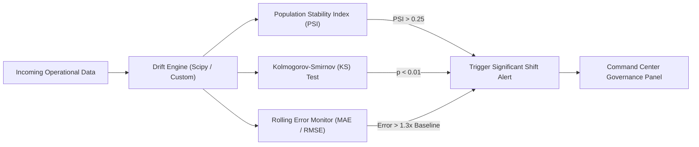

# Machine Learning Roadmap: Integrated Hospital Operations Intelligence

**Document Version:** 1.0.0  
**Status:** Approved Phase 0 Baseline  
**ML Frameworks:** Scikit-Learn, LightGBM, XGBoost, Statsmodels, SHAP  
**Validation Strategy:** Strict Rolling-Origin Time-Series Cross-Validation (Zero Future Data Leakage)  

---

## 1. Machine Learning Architectural Principles

1. **Defensible Baselines First:** Every complex ML model must be benchmarked against a transparent statistical baseline (e.g., Seasonal Naive, Exponential Smoothing, or Historical Medians). A complex model is only adopted if it achieves a measurable reduction in out-of-sample error and operational risk.
2. **Strict Leakage Prevention:** Features are constructed exclusively using information available up to the exact prediction timestamp $T_{\text{pred}}$. In patient-level tasks, patient grouping (`GroupKFold` or chronological holdout) ensures that historical encounters from the same patient never leak into test folds.
3. **Uncertainty Quantification:** Point forecasts are accompanied by prediction intervals (80% and 95% quantiles) using Quantile Regression or Conformal Prediction.
4. **Actionable Explainability:** Local SHAP waterfall plots explain individual predictions for clinical reviewers, while global beeswarm charts guide operational governance. SHAP values reflect feature contribution weights, never medical causality.

---

## 2. Predictive Tasks Specification Matrix

### Task 1: Emergency Department Hourly Arrival Forecasting (Module 1)
* **Objective:** Forecast patient arrival counts in the Emergency Department per hourly interval for 24h, 48h, and 72h horizons.
* **Prediction Unit:** Hospital ED, aggregated hourly count.
* **Prediction Horizon:** $H \in \{24, 48, 72\}$ hours ahead.
* **Target Variable:** $Y_{t+h} = \text{Total arrivals in hour } [t+h, t+h+1)$.
* **Feature Engineering:**
  * *Calendar/Cyclical:* Hour of day ($\sin / \cos$ transformation), day of week, weekend indicator, holiday flag.
  * *Lags:* $Y_{t-1}, Y_{t-2}, Y_{t-24}, Y_{t-48}, Y_{t-168}$ (same hour last week).
  * *Rolling Aggregations:* 6-hour, 24-hour, and 7-day rolling mean, standard deviation, and min/max.
  * *Operational Momentum:* Rate of change in triage volume over the preceding 3 hours.
* **Baseline Models:**
  1. *Seasonal Naive:* $\hat{Y}_{t+h} = Y_{t+h-168}$ (Arrivals at the same hour on the same day in the previous week).
  2. *Moving Average:* 4-week historical hourly median.
* **Candidate ML Models:**
  * Ridge Regression (L2 linear baseline)
  * LightGBM Regressor (Tuned with Poisson objective for count data)
  * Random Forest Regressor
* **Evaluation Metrics:** Mean Absolute Error (MAE), Root Mean Squared Error (RMSE), Weighted Absolute Percentage Error (WAPE), Mean Absolute Scaled Error (MASE).

---

### Task 2: Inpatient Length of Stay (LOS) & Bed Release Estimation (Module 2)
* **Objective:** Estimate remaining Length of Stay in hours for admitted patients upon ward placement to forecast when beds will be vacated.
* **Prediction Unit:** Inpatient encounter at admission / transfer.
* **Prediction Horizon:** Admission timestamp through discharge.
* **Target Variable:** Continuous hours from admission event to discharge event ($\text{LOS}_{\text{hours}}$).
* **Feature Engineering:**
  * Patient age group, gender, admission source (ED vs. Elective).
  * Triage ESI score (1 to 5), primary diagnosis category.
  * Laboratory order volume, initial vital sign stability indicators.
  * Admitting ward specialty, admission day of week, hour of admission.
* **Leakage Guards:** Exclude discharge disposition, discharge instructions, or post-admission complications that occur after $T_{\text{admit}}$.
* **Baseline Model:** Historical median LOS grouped by Primary Diagnosis and Age Bracket.
* **Candidate ML Models:**
  * Gradient Boosted Decision Trees (XGBoost / LightGBM) with Quantile Loss ($q_{0.1}, q_{0.5}, q_{0.9}$).
  * Log-transformed Linear Ridge Regression.
* **Evaluation Metrics:** MAE (hours), Median Absolute Error, Continuous Ranked Probability Score (CRPS), 80% Prediction Interval Coverage Probability (PICP).

---

### Task 3: 24h / 48h / 72h Ward Overcrowding Risk Classification (Module 1 & 2)
* **Objective:** Predict the binary probability of an operational ward exceeding 90% and 100% staffed bed capacity over upcoming time blocks.
* **Prediction Unit:** Ward level, computed every 6 hours.
* **Target Variable:** Binary flag: $1 \text{ if } \text{StaffedOccupancy}_{t+h} \ge \text{Threshold}$, else $0$.
* **Feature Engineering:**
  * Current ward occupancy % (Physical vs. Staffed).
  * Upstream M1 forecasted arrivals destined for inpatient admission.
  * Downstream M2 expected discharges over the next $h$ hours.
  * Scheduled on-duty nursing coverage for the upcoming shifts.
* **Baseline Model:** Static persistence (Current occupancy status projected forward).
* **Candidate ML Models:** Calibrated Logistic Regression, LightGBM Classifier.
* **Evaluation Metrics:** Precision-Recall AUC (PR-AUC), Brier Calibration Score, Sensitivity (Recall) at fixed 85% Specificity, Warning Lead Time (hours).

---

### Task 4: 30-Day Hospital Readmission Risk (Module 6)
* **Objective:** Identify discharged inpatients who face high risk of unplanned readmission within 30 days to enable proactive post-discharge coordination.
* **Prediction Unit:** Inpatient discharge encounter.
* **Target Variable:** Binary $Y \in \{0, 1\}$ (Unplanned readmission within 720 hours of discharge).
* **Feature Engineering:**
  * Total Length of Stay of index encounter.
  * Number of prior emergency/inpatient admissions in the past 12 months.
  * Discharge destination (Home, Skilled Nursing, Rehabilitation).
  * Comorbidity index (Charlson-like synthetic comorbidity count).
* **Clinical Safety Boundary:** Strictly advisory for discharge planning; never used to deny admission, reduce care intensity, or accelerate discharge.
* **Baseline Model:** Logistic Regression with L1 regularization.
* **Candidate ML Models:** Tuned XGBoost Classifier with Platt Scaling calibration.
* **Evaluation Metrics:** PR-AUC, ROC-AUC, Brier Score, Top-Decile Lift.
* **Explainability:** SHAP TreeExplainer generates a local waterfall chart highlighting the top 5 risk drivers for clinical case managers.

---

## 3. Model Governance & Data Drift Detection (Module 7)

To ensure sustained reliability and guard against model decay, the platform embeds real-time data governance metrics:

1. **Population Stability Index (PSI):**
   $$\text{PSI} = \sum \left( \text{Actual}_i - \text{Expected}_i \right) \times \ln\left(\frac{\text{Actual}_i}{\text{Expected}_i}\right)$$
   * $\text{PSI} < 0.1$: Stable (Green).
   * $0.1 \le \text{PSI} < 0.25$: Moderate drift (Amber warning).
   * $\text{PSI} \ge 0.25$: Significant population drift (Red alert; requires inspection).
2. **Two-Sample Kolmogorov-Smirnov Test:** Continuously tests numeric feature distributions (e.g., patient arrival intervals, triage acuity) between the training baseline and a sliding 7-day operational window.
3. **Rolling Prediction Residuals:** Tracks real-time MAE/RMSE as true observed values materialize. An alert is flagged if error exceeds $130\%$ of the historical cross-validation benchmark.
